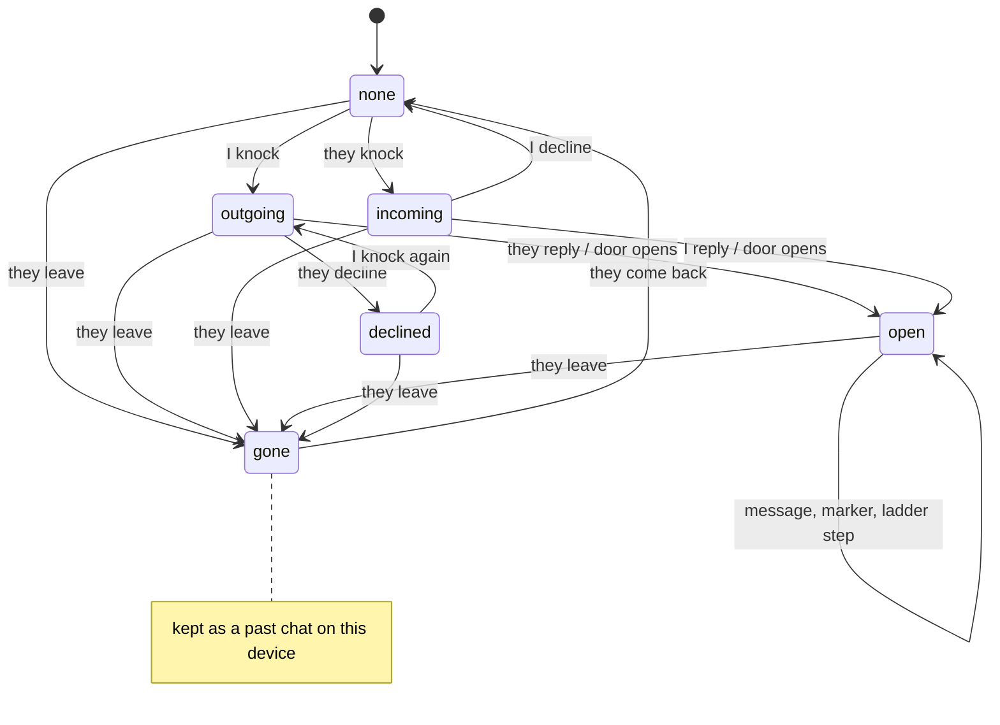
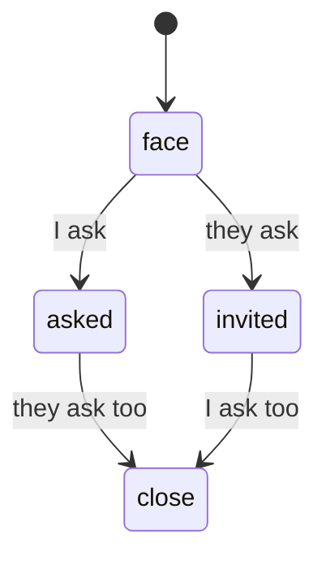
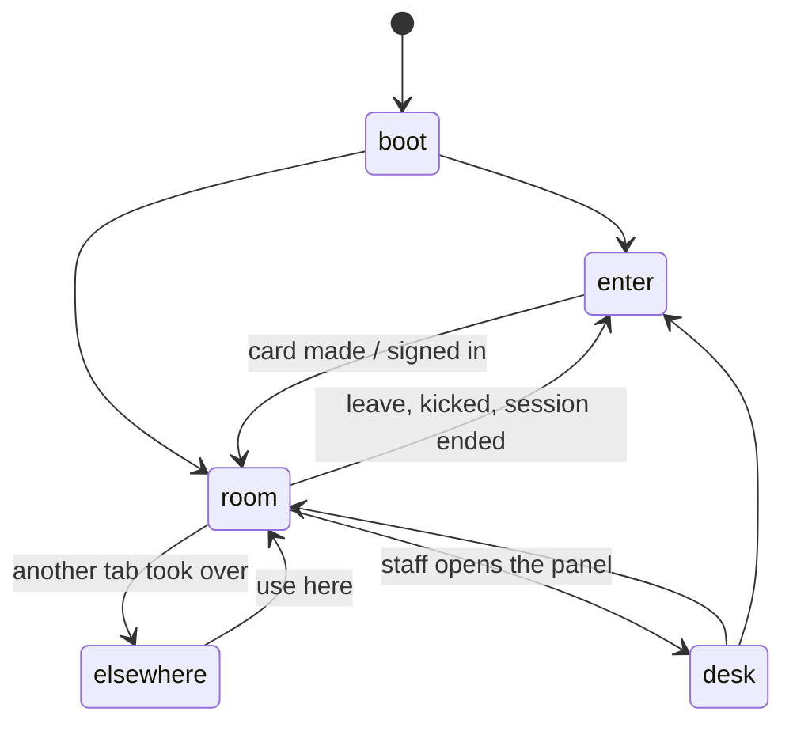
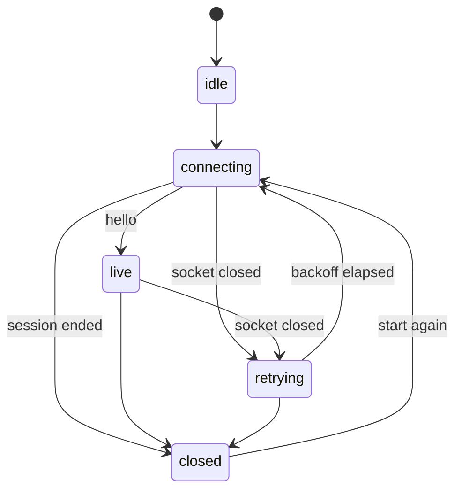

# Drift: UI state machines

Oct 16, 2026 · @Vedant

## Problem

The client tracked a private chat with a loose `phase` string that six
handlers set directly. Nothing stopped a handler from making a move the
product never designed, and several gaps followed from it:

- An incoming knock had no way out but replying or blocking. It came back
  after every reload, without its text.
- An open chat came back empty after a reload, although its messages were
  kept on the device.
- Every message rebuilt the whole chats pane, so the door banner and its
  photo faded out and back in on each send.
- A knock was a four-second toast at the bottom of the screen, over the
  room composer, and gone before most people read it.

## Constraints

- The server stays the source of truth for doors. The client models what
  it shows; a `hello` after a reconnect can always resync it.
- No build step: plain ES modules, one small helper, no library.
- Safety rules from `warmth-yearning-safety.md` hold in every state: a
  knock is text only, photos wait for both to get closer, either side can
  block at any point.

## Design

Every piece of UI state that changes over time is a machine: a table of
`state -> event -> next state`. `web/machine.js` holds the helper. A move
that is not in the table is refused and reported, so the UI can never sit
in a state nobody designed. On localhost a refused move also shows a toast,
which makes the bugs the simulator shakes out visible.

### A private chat (one per person)

Blocking removes the chat in any state. `hello` after a reconnect replays
the server's doors with a `sync` event, the one move allowed from anywhere.

| State | Composer | Main panel | List |
| --- | --- | --- | --- |
| none | "Write your knock" | Their card, knock help | Not listed |
| outgoing | Disabled | My knock, "wait for them" | "Knock sent" |
| incoming | "Reply to open the door" | Their knock, Decline, Block | Top of list, "Knocked" |
| open | Messages; media once close | Thread, ladder bar | By last message |
| declined | Disabled, Knock again | "Not this time" | Faded |
| gone | Replaced by the ended bar | Thread, read only | Faded |

### The reveal ladder (inside open)

The server sends the two flags; the client turns them into a ladder state
and refuses anything that would step back down.

### Knock notifications

A knock asks for a decision, so it is not a toast. It goes to a tray under
the top bar, on the right where the Chats tab is, and stays until the
person opens it, declines it, or the knocker leaves. Several knocks stack,
newest first, at most three with a "+N more" line. The tray never covers
either composer.

### Screen and connection

## Server changes

- `decline {user_id}`: the person knocked declines. The door is removed and
  both sides get `door_closed {with, reason: "declined"}`.
- The door keeps its knock (id, text, time) and `hello` replays it, so a
  reload shows the same knock rather than an empty panel.

## Rendering

Moves inside a state (a new message in an open chat) append one bubble and
update one list row. Only a change of state redraws the chat view. The
door banner animates once, when it first appears.

## Trade-off

A table per machine is more ceremony than setting a string. It buys a
single place to read every allowed move, and refused moves that point at
the exact bug, which is what a stranger-chat app with knocks, ladders,
reconnects and blocks needs most.

## Testing

`cmd/simulate` connects scripted guests that chat in the room, knock,
reply, decline, get closer, leave and come back. Run it against a local
server while using the app in a browser to see every state from both sides.
